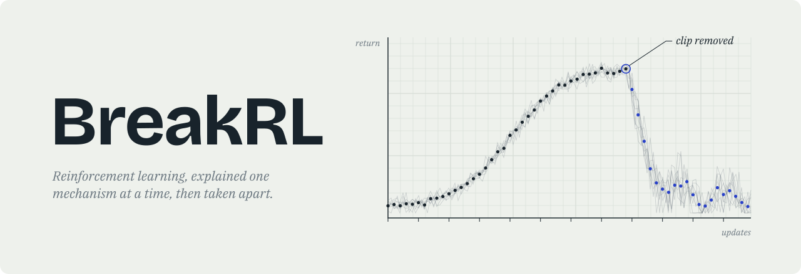

<div align="center">

<picture>
  <source media="(prefers-color-scheme: dark)" srcset=".github/assets/banner-dark.svg">
  
</picture>

一套中英双语的强化学习讲义，14 章，从多臂老虎机一路讲到 GRPO。

<a href="https://github.com/Powfu-zwx/BreakRL/stargazers"></a>
<a href="https://doi.org/10.5281/zenodo.21966485"></a>
<a href="LICENSE-MIT"></a>
<a href="LICENSE-CC-BY-4.0"></a>
<a href="requirements.txt"></a>

<b><a href="https://powfu-zwx.github.io/BreakRL/">在线阅读</a>&nbsp;&nbsp;&nbsp;&nbsp;<a href="https://powfu-zwx.github.io/BreakRL/demo.html">交互演示</a>&nbsp;&nbsp;&nbsp;&nbsp;<a href="https://powfu-zwx.github.io/BreakRL/failure-atlas.html#atlas-8-offline-loss">失败图鉴</a>&nbsp;&nbsp;&nbsp;&nbsp;<a href="README.md">English</a></b>

</div>


## 这套讲义在做什么

学 RL 时最让人头疼的，往往不是公式，而是训练跑完了、曲线也有了，却说不清它为什么好、为什么坏。

所以这里每一章都分三步：先从头推导，再给一份能直接跑的 Notebook，最后把算法里的某个关键零件拿掉，重新训练一遍。DQN 去掉经验回放，PPO 去掉 clip，RLHF 把 KL 系数设成 0……拆完之后算法怎么坏、坏成什么样，比任何一段文字解释都更有说服力。

拆出来的典型故障整理成了一份 [失败图鉴](https://powfu-zwx.github.io/BreakRL/failure-atlas.html#atlas-8-offline-loss)，共 17 条，按“症状 → 原因 → 复现 → 修法”排列。训练卡住时可以直接按症状去查。

## 三分钟上手

不用装任何东西：

1. 打开 [交互演示](https://powfu-zwx.github.io/BreakRL/demo.html)，把“数据覆盖率”滑块往左拖，看损失和回报怎么分道扬镳；
2. 读 [失败图鉴第 8 条](https://powfu-zwx.github.io/BreakRL/failure-atlas.html#atlas-8-offline-loss)，弄清楚背后的外推误差；
3. 再去看第 9 章离线 RL，看 CQL 和 IQL 分别怎么把它修好。

走完这一圈，基本就知道每一章是什么读法了。不必从第 1 章开始按顺序读。

## 每一章拆掉了什么

| 章 | 拿掉的东西 | 你会看到 |
| --- | --- | --- |
| 1 老虎机 | 探索（纯贪心） | 约三成种子被次优臂困死 |
| 2 MDP | 不拆，打地基 | 策略迭代和值迭代的收敛过程 |
| 3 TD | 换掉 on/off-policy、调 n 步 | Cliff Walking 上 SARSA 与 Q-learning 走出两条路 |
| 4 DQN | 经验回放、目标网络 | CartPole 回报停在 10 左右；曲线剧烈震荡 |
| 5 REINFORCE | 基线、熵正则 | 回报全是噪声；熵早早塌到 0 |
| 6 Actor-Critic | A2C 的各项稳定手段 | 优势塌缩，回报从第一回合起就钉死在 9 左右 |
| 7 PPO | clip | LunarLander 中途崩盘，回报最低跌到 −8000 量级 |
| 8 SAC | 熵项、双 Q、软更新 | 探索消失、Q 高估、目标跳变 |
| 9 离线 RL | 保守性（朴素离线 DQN） | Q 一路涨，回报远低于 BC |
| 10 模型式 RL | 准确的环境模型 | 规划越多，偏差放大得越厉害 |
| 11 Decision Transformer | 数据范围内的回报目标 | 目标设得再高也没用；拼不出最优路径 |
| 12 RLHF | KL 约束（β=0） | 代理奖励一直涨，真实质量崩掉 |
| 13 DPO | 足够大的 β、提前停止 | 损失还在降，生成越来越差 |
| 14 GRPO | 冷启动 SFT | 组内奖励全为 0，一步也学不动 |

第 12–14 章用的是玩具任务，目的是看清后训练的机制，不是复现大模型的结果。

## 章节

每章都有正文 PDF、网页版 Notebook（带保存好的输出）和 Colab 链接。

<!-- chapters:begin -->
| # | 章节 | 正文 | 实验 | 运行 |
| --- | --- | --- | --- | --- |
| 1 | 多臂老虎机：探索与利用 | [PDF](book/notes/multi-armed-bandit/multi-armed-bandit.pdf) | [Notebook](https://powfu-zwx.github.io/BreakRL/notes/multi-armed-bandit/multi-armed-bandit.html) | [Colab](https://colab.research.google.com/github/Powfu-zwx/BreakRL/blob/main/book/notes/multi-armed-bandit/multi-armed-bandit.ipynb) |
| 2 | 马尔可夫决策过程：序列决策形式化 | [PDF](book/notes/mdp/mdp.pdf) | [Notebook](https://powfu-zwx.github.io/BreakRL/notes/mdp/mdp.html) | [Colab](https://colab.research.google.com/github/Powfu-zwx/BreakRL/blob/main/book/notes/mdp/mdp.ipynb) |
| 3 | 时序差分学习：长期价值估计 | [PDF](book/notes/temporal-difference-learning/temporal-difference-learning.pdf) | [Notebook](https://powfu-zwx.github.io/BreakRL/notes/temporal-difference-learning/temporal-difference-learning.html) | [Colab](https://colab.research.google.com/github/Powfu-zwx/BreakRL/blob/main/book/notes/temporal-difference-learning/temporal-difference-learning.ipynb) |
| 4 | DQN：神经网络价值学习 | [PDF](book/notes/dqn/dqn.pdf) | [Notebook](https://powfu-zwx.github.io/BreakRL/notes/dqn/dqn.html) | [Colab](https://colab.research.google.com/github/Powfu-zwx/BreakRL/blob/main/book/notes/dqn/dqn.ipynb) |
| 5 | Policy Gradient / REINFORCE：直接优化策略 | [PDF](book/notes/policy-gradient/policy-gradient.pdf) | [Notebook](https://powfu-zwx.github.io/BreakRL/notes/policy-gradient/policy-gradient.html) | [Colab](https://colab.research.google.com/github/Powfu-zwx/BreakRL/blob/main/book/notes/policy-gradient/policy-gradient.ipynb) |
| 6 | Actor-Critic / A2C：价值辅助策略更新 | [PDF](book/notes/actor-critic/actor-critic.pdf) | [Notebook](https://powfu-zwx.github.io/BreakRL/notes/actor-critic/actor-critic.html) | [Colab](https://colab.research.google.com/github/Powfu-zwx/BreakRL/blob/main/book/notes/actor-critic/actor-critic.ipynb) |
| 7 | PPO：约束策略更新 | [PDF](book/notes/ppo/ppo.pdf) | [Notebook](https://powfu-zwx.github.io/BreakRL/notes/ppo/ppo.html) | [Colab](https://colab.research.google.com/github/Powfu-zwx/BreakRL/blob/main/book/notes/ppo/ppo.ipynb) |
| 8 | SAC：最大熵连续控制 | [PDF](book/notes/sac/sac.pdf) | [Notebook](https://powfu-zwx.github.io/BreakRL/notes/sac/sac.html) | [Colab](https://colab.research.google.com/github/Powfu-zwx/BreakRL/blob/main/book/notes/sac/sac.ipynb) |
| 9 | 离线强化学习：CQL 与 IQL | [PDF](book/notes/offline-rl/offline-rl.pdf) | [Notebook](https://powfu-zwx.github.io/BreakRL/notes/offline-rl/offline-rl.html) | [Colab](https://colab.research.google.com/github/Powfu-zwx/BreakRL/blob/main/book/notes/offline-rl/offline-rl.ipynb) |
| 10 | 模型式强化学习：从环境模型到 Dyna-Q | [PDF](book/notes/model-based-rl/model-based-rl.pdf) | [Notebook](https://powfu-zwx.github.io/BreakRL/notes/model-based-rl/model-based-rl.html) | [Colab](https://colab.research.google.com/github/Powfu-zwx/BreakRL/blob/main/book/notes/model-based-rl/model-based-rl.ipynb) |
| 11 | Decision Transformer：序列建模的强化学习 | [PDF](book/notes/decision-transformer/decision-transformer.pdf) | [Notebook](https://powfu-zwx.github.io/BreakRL/notes/decision-transformer/decision-transformer.html) | [Colab](https://colab.research.google.com/github/Powfu-zwx/BreakRL/blob/main/book/notes/decision-transformer/decision-transformer.ipynb) |
| 12 | RLHF：从偏好到奖励 | [PDF](book/notes/rlhf/rlhf.pdf) | [Notebook](https://powfu-zwx.github.io/BreakRL/notes/rlhf/rlhf.html) | [Colab](https://colab.research.google.com/github/Powfu-zwx/BreakRL/blob/main/book/notes/rlhf/rlhf.ipynb) |
| 13 | DPO：不训奖励模型的偏好优化 | [PDF](book/notes/dpo/dpo.pdf) | [Notebook](https://powfu-zwx.github.io/BreakRL/notes/dpo/dpo.html) | [Colab](https://colab.research.google.com/github/Powfu-zwx/BreakRL/blob/main/book/notes/dpo/dpo.ipynb) |
| 14 | GRPO 与 RLVR：可验证奖励 | [PDF](book/notes/grpo/grpo.pdf) | [Notebook](https://powfu-zwx.github.io/BreakRL/notes/grpo/grpo.html) | [Colab](https://colab.research.google.com/github/Powfu-zwx/BreakRL/blob/main/book/notes/grpo/grpo.ipynb) |
<!-- chapters:end -->

## 在本地跑

<details>
<summary>展开本地安装步骤</summary>

最省事的是点表里的 Colab。想在本地跑的话，用 Python 3.10：

```bash
conda create -n rl_env python=3.10
conda activate rl_env
python -m pip install -r requirements.txt
python -m ipykernel install --user --name rl_env --display-name rl_env
python tools/run_jupyter.py
```

然后打开 `book/notes/<章节>/<章节>.ipynb`，内核选 `rl_env`。不带后缀的是中文版，带 `-en` 的是英文版。

</details>

## 仓库结构

```
book/
  notes/          各章的 TeX、PDF、Notebook 和图
  chapters.yml    章节清单，README 和网站目录都从这里生成
  _toc.yml        Jupyter Book 目录（自动生成，别手改）
tools/            构建和检查脚本
```

想增删章节或改标题，只改 `book/chapters.yml`，然后运行 `python tools/sync_pages.py` 同步页面，再用 `python tools/check_repo.py` 检查一遍。改了 TeX 记得重新编译对应的 PDF。发现推导错误或实验跑不通，欢迎直接开 issue。

## 许可与引用

正文、图表和数据采用 [CC BY 4.0](LICENSE-CC-BY-4.0)，代码采用 [MIT](LICENSE-MIT)。

如果在课程、论文或其他公开内容中用到了 BreakRL，请按 [CITATION.cff](CITATION.cff) 引用，或点 GitHub 右侧栏的 “Cite this repository” 直接复制 BibTeX。

## Star History

[](https://star-history.com/#Powfu-zwx/BreakRL&Date)
